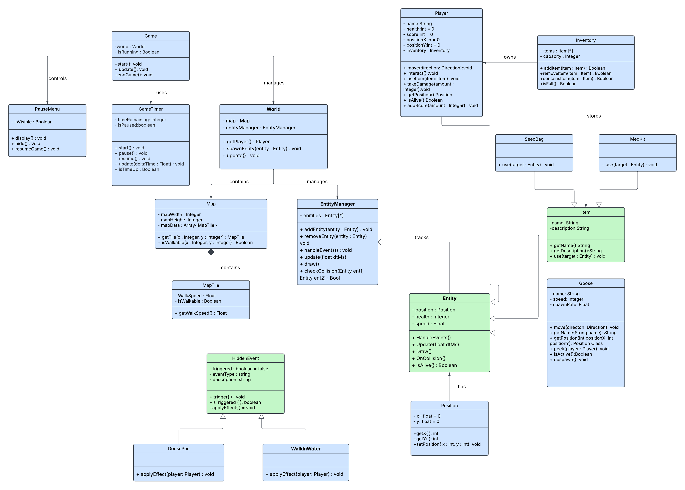
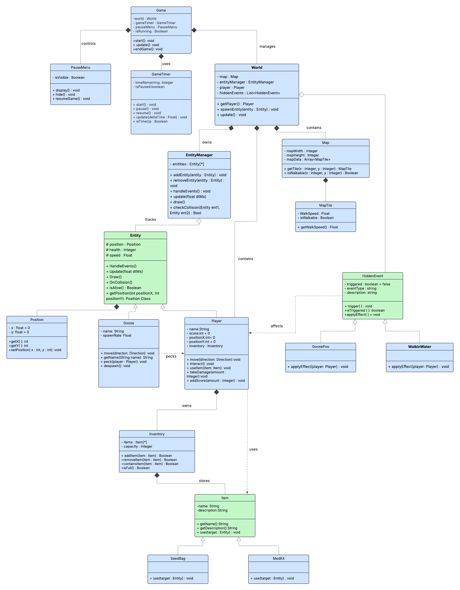
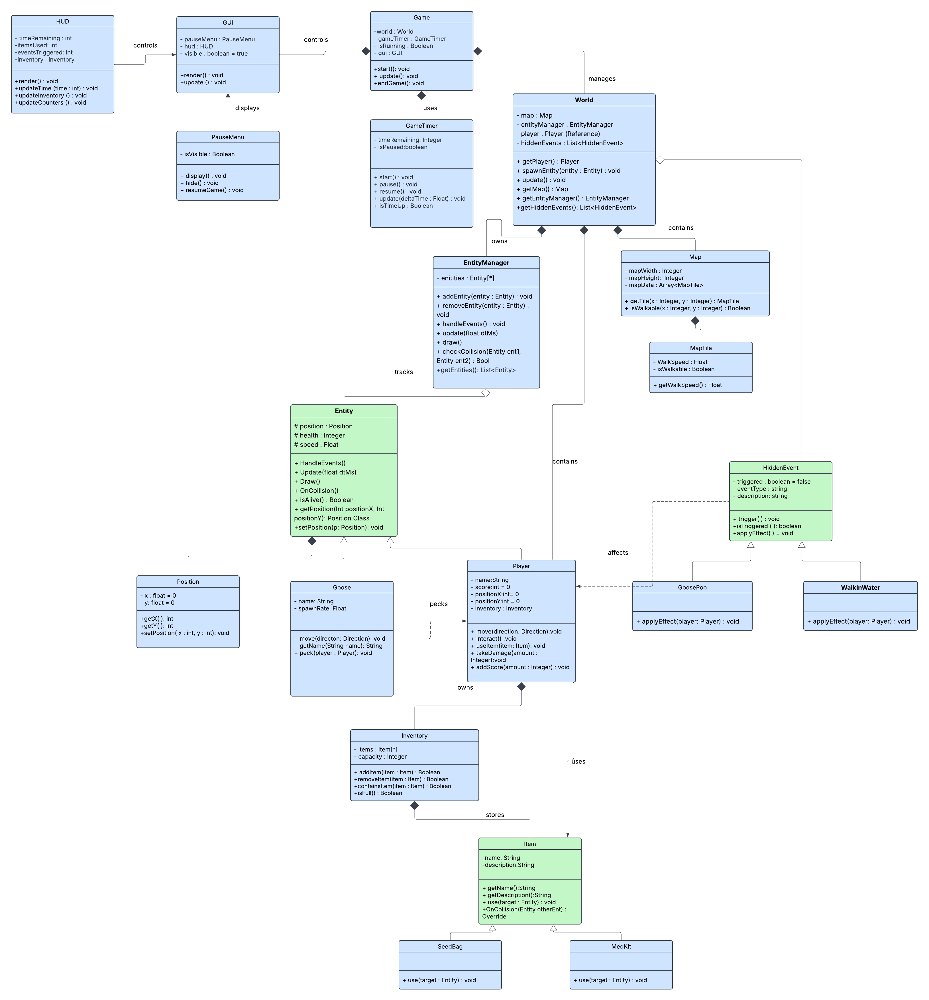
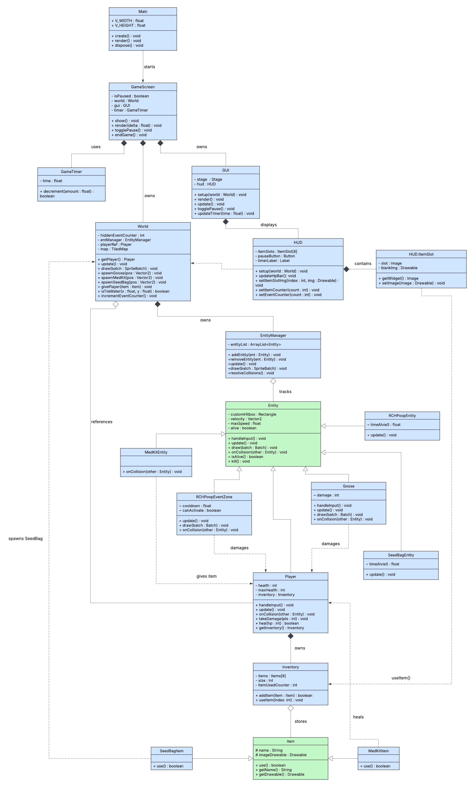
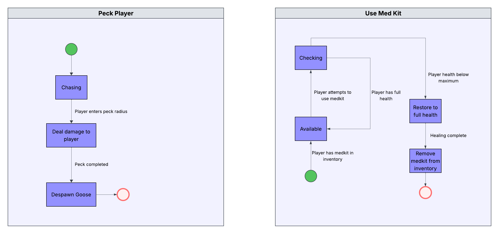

# For all things Goose Patrol

## Links to files and github repository

Requirements PDF - [Req1](pdfs/Req1.pdf)

Architecture PDF - [Arch1](pdfs/Arch1.pdf)

Method selection and planning PDF - [Plan1](pdfs/Plan1.pdf)

Risk assessment and mitigation PDF - [Risk1](pdfs/Risk1.pdf)

Implementation PDF - [Impl1](pdfs/Impl1.pdf)

The executable JAR of the game - [JAR](pdfs/GoosePatrol-1.0.0.jar)

Our team's version-control repository - [Goose Patrol Project](https://github.com/kgg523/goose-patrol-project)

## Class Diagram Evolution

First Draft of class diagram (9/10/26)

Second Draft of class diagram (16/10/26)

Third Draft of class diagram (23/10/26)

Fourth and Fianl Draft of class diagram (12/11/26)

## State Diagrams 

Peck player and Med kit state diagrams

These state diagrams display the functionality of when a player is pecked and when a player uses the medkit item:

The peck player diagram -  the goose begins chasing the player. When the player enters the specific radius of the goose, the goose is close enough to peck the player. When the player is pecked,  10 damage is then dealt to the player’s health variable. The peck is then completed, and the goose’s despawns. This functionality applies to each individual goose allowing them to attack in flocks.
The medkit state diagram - If the player has the medkit in their inventory, then the available boolean for medkit is set to true. When the player attempts to use the medkit, if the player already has full health then the medkit effect is not applied. Otherwise, the player’s health is restored to full and the medkit is removed from the inventory.

